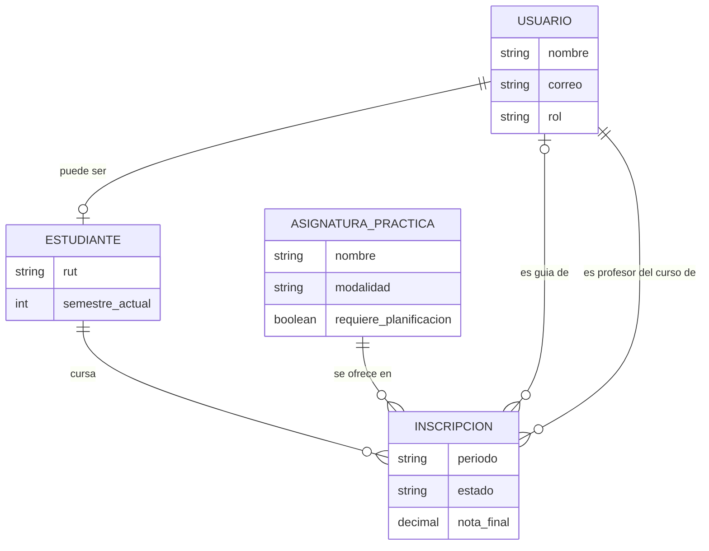
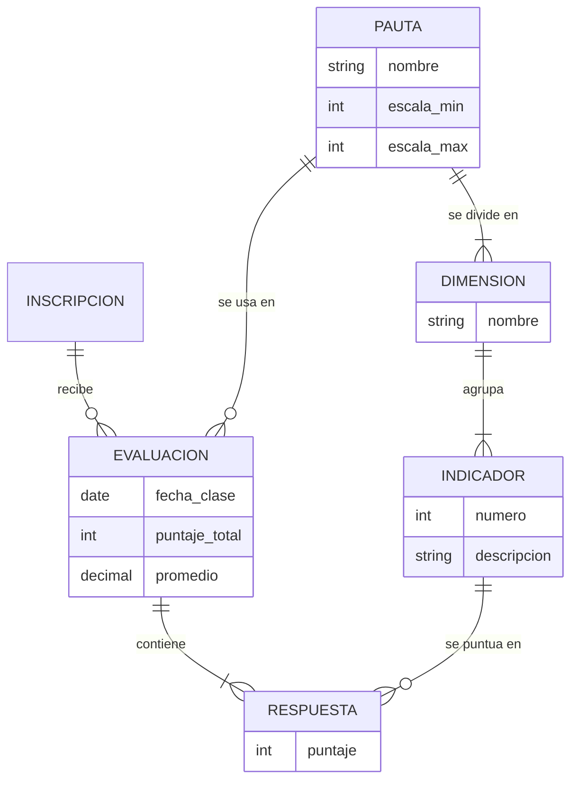
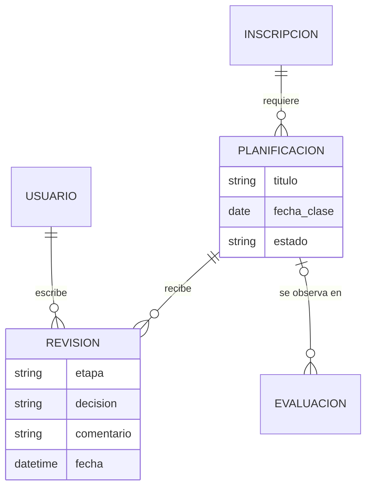
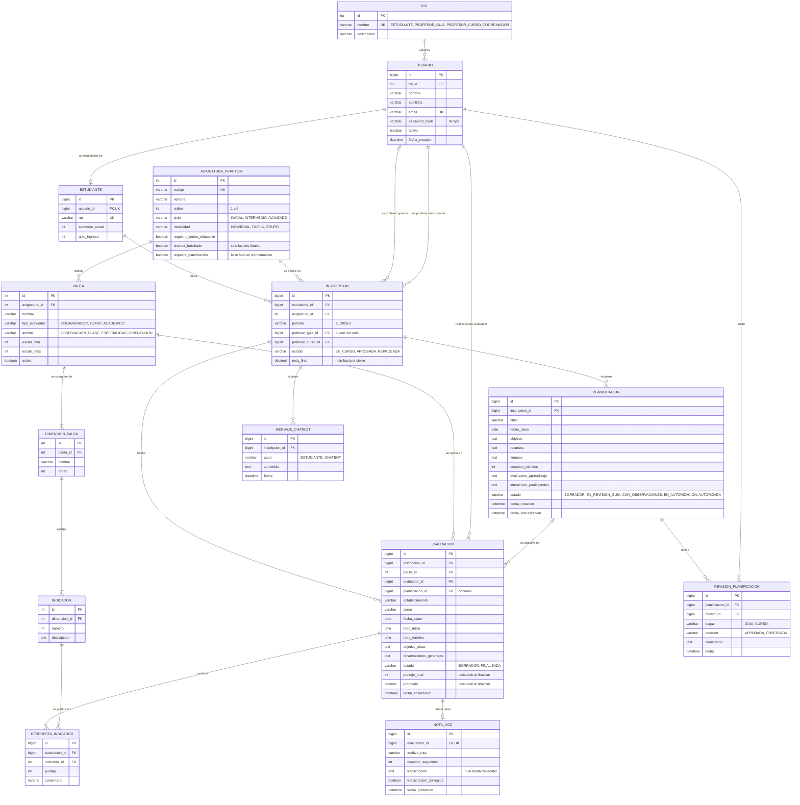
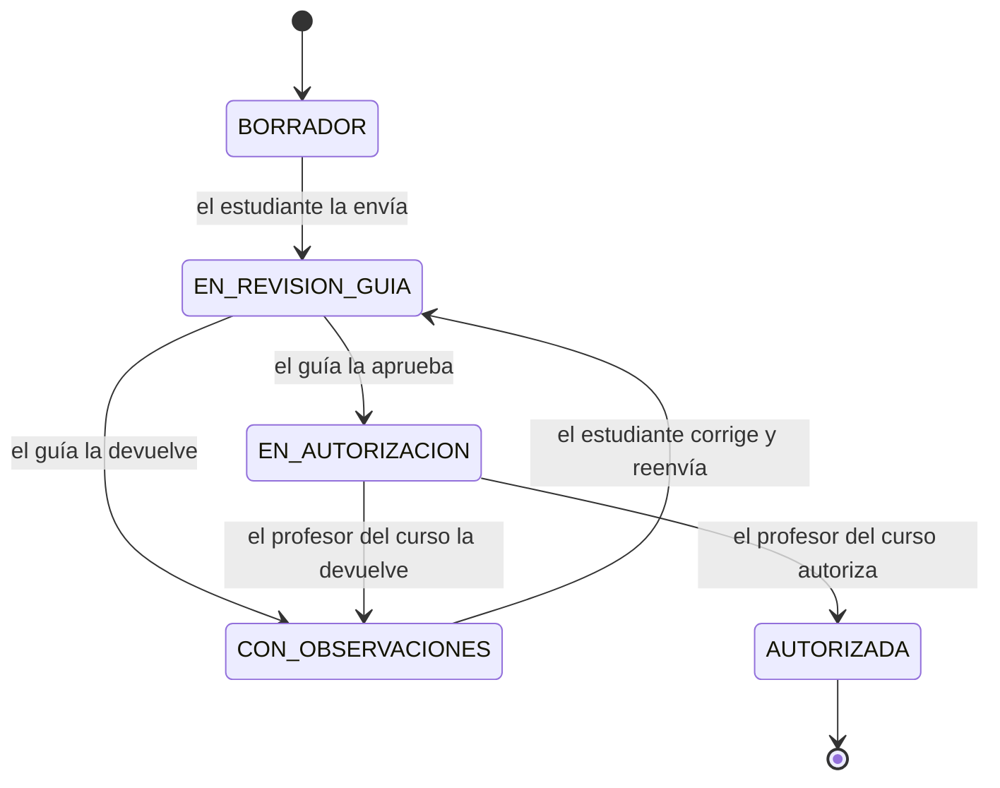

# Modelo Entidad-Relación (MER) — Sistema de Formación Práctica PEM-UBB

Este es el modelo de la base de datos MySQL del proyecto (`db/schema.sql`). Lo armamos a partir de la entrevista con el cliente y de las pautas reales de la carrera, sobre todo la *pauta de observación de clase del profesor colaborador*: 20 indicadores, escala de 1 a 7, en 3 dimensiones.

Cómo está ordenado este archivo:

1. La idea en simple.
2. **Vista simple en 3 partes**: para dibujar a mano y para la presentación.
3. **Modelo completo**: el que realmente tiene la base de datos (con tipos, claves y todo).
4. Entidades y relaciones explicadas con palabras.
5. Reglas que el diagrama no puede mostrar, y qué entra en el Sprint 1.
6. Supuestos y preguntas de defensa.

## 1. La idea en simple

El cliente quiere poder responder estas preguntas con el sistema:

| Pregunta del cliente | Qué tablas la responden |
|---|---|
| ¿Quién es el estudiante y en qué práctica está? | `USUARIO`, `ESTUDIANTE`, `ASIGNATURA_PRACTICA`, `INSCRIPCION` |
| ¿Quién lo guía y quién autoriza sus clases? | `INSCRIPCION` (guarda su profesor guía y su profesor del curso) |
| ¿Cómo lo evaluaron, indicador por indicador? | `PAUTA`, `DIMENSION_PAUTA`, `INDICADOR`, `EVALUACION`, `RESPUESTA_INDICADOR` |
| ¿Qué planificó y quién se lo aprobó? | `PLANIFICACION`, `REVISION_PLANIFICACION` |
| ¿Cuál es su recorrido por las 6 prácticas? | Sus `INSCRIPCION` ordenadas en el tiempo, con lo que cuelga de cada una |
| (Más adelante) ¿Qué dijo el profesor en su nota de voz? ¿Qué le respondió el chatbot? | `NOTA_VOZ`, `MENSAJE_CHATBOT` |

Tres decisiones que conviene recordar:

1. **La inscripción es el centro.** Una inscripción es "un estudiante cursando una asignatura en un periodo" (por ejemplo, Camila en Trabajo Colaborativo 2026-2). De ahí cuelgan las planificaciones, las evaluaciones y, más adelante, el chat. Por eso el historial de un estudiante es simplemente la lista de sus inscripciones ordenada por fecha.
2. **La pauta es un dato, no código.** Las dimensiones, los indicadores y la escala están en tablas. Si mañana la carrera usa otra pauta (escala de 2 a 7, Orientación, tutor), se agrega como datos nuevos sin tocar el programa.
3. **Nada importante se sobrescribe.** Cada decisión sobre una planificación queda como una fila nueva en `REVISION_PLANIFICACION`, y una evaluación finalizada ya no se puede cambiar. Así hay evidencia para la acreditación.

## 2. Vista simple en 3 partes

Estos tres dibujos muestran lo mismo que el modelo completo, pero con pocos datos por tabla y sin claves. Son los que conviene copiar a mano y explicar en la presentación. Se pueden ver pegándolos en <https://mermaid.live>.

En Mermaid cada dato lleva una palabra de tipo (`string`, `int`...): ignórenla al dibujar. Cómo leer las líneas: `||` es "exactamente uno", `o|` es "cero o uno", `o{` es "cero o muchos" y `|{` es "uno o muchos".

### Parte A. Personas y prácticas

Cómo se cuenta: "Un usuario puede ser estudiante. Un estudiante cursa muchas inscripciones a lo largo de sus 6 prácticas. Cada inscripción es de una asignatura y tiene su profesor del curso y, si la asignatura va a un colegio, su guía".

### Parte B. Evaluación con la pauta

Cómo se cuenta: "Una pauta tiene dimensiones y cada dimensión tiene indicadores (en la pauta real, 20). Cada vez que un guía evalúa una clase se crea una evaluación con una respuesta por indicador. El puntaje total y el promedio se calculan solos al finalizar".

### Parte C. Planificación y sus revisiones

Cómo se cuenta: "Un estudiante escribe una planificación por cada clase. El guía y el profesor del curso la revisan: cada decisión queda guardada con quién, cuándo y qué comentó. Si la planificación se usó para una clase evaluada, la evaluación puede apuntar a ella".

### Un ejemplo con datos de la demo

Camila Rojas (estudiante 1) tiene una inscripción en Trabajo Colaborativo 2026-2 (la inscripción 3), con Marcos Bravo como guía y Ricardo Núñez como profesor del curso. De esa inscripción cuelgan tres planificaciones: una autorizada, una con observaciones y un borrador. Cada revisión de Marcos o de Ricardo es una fila en `REVISION_PLANIFICACION`. Si Marcos evalúa una clase suya, aparece una fila en `EVALUACION` con 20 filas en `RESPUESTA_INDICADOR`.

## 3. Modelo completo (el que tiene la base de datos)

Este es el diagrama con todos los campos, tipos y claves (`PK` clave primaria, `FK` clave foránea, `UK` único). Son las 14 tablas del script `db/schema.sql`.

> Ejemplo de lectura de una línea: `ESTUDIANTE ||--o{ INSCRIPCION` se lee "un estudiante tiene cero o muchas inscripciones; cada inscripción es de exactamente un estudiante".

## 4. Entidades

Las 12 primeras se usan en el Sprint 1. Las dos últimas (`NOTA_VOZ`, `MENSAJE_CHATBOT`) se crean en la base de datos para que el modelo esté completo, pero su API llega en sprints posteriores (HU-11, HU-12 y HU-15).

| Entidad | Qué representa (en simple) | Puntos clave | HU |
|---|---|---|---|
| `ROL` | Catálogo de los tipos de usuario: estudiante, profesor guía, profesor del curso y coordinador | Es una tabla y no un texto libre para que nadie invente un rol | HU-01 |
| `USUARIO` | Cualquier persona que entra al sistema | Guarda la contraseña **cifrada** (`password_hash`), nunca en texto plano. Cada usuario tiene un rol (S-11) | HU-01 |
| `ESTUDIANTE` | Los datos propios de un usuario que es estudiante | Se separa de `USUARIO` porque solo los estudiantes tienen RUT, semestre y año de ingreso. `semestre_actual` es parte del contexto del chatbot (S-14) | HU-02 |
| `ASIGNATURA_PRACTICA` | Cada una de las 6 asignaturas de práctica | `chatbot_habilitado` es verdadero solo en las dos finales. `ciclo` y `modalidad` reflejan la estructura del cliente: Aproximación al Sistema Escolar es `GRUPO` (de 4) y Ambientes de Aprendizaje `DUPLA` (S-16, según un estudiante). `requiere_planificacion` es falso solo en Aproximación (solo trabajos en clase) | HU-02 |
| `INSCRIPCION` | Un estudiante cursando una asignatura en un periodo | Es el centro del modelo. Guarda quién es su guía (nulo en el ciclo inicial, que no va al colegio) y quién es su profesor del curso. Las asignaturas aprobadas se obtienen de aquí (`estado = APROBADA`) | HU-02, HU-05 |
| `PAUTA` | Un instrumento de evaluación (por ejemplo, la pauta de observación de clase) | Define su escala (`escala_min`, `escala_max`) y quién la aplica (`tipo_evaluador`) | HU-03 |
| `DIMENSION_PAUTA` | Un grupo de indicadores de una pauta | En la pauta real son 3: estructura de la clase, tareas matemáticas, y ambiente de aula y recursos | HU-03 |
| `INDICADOR` | Cada criterio que se puntúa | La pauta real tiene 20 | HU-03 |
| `EVALUACION` | Una clase evaluada con una pauta | Guarda los datos de la cabecera de la pauta en papel (establecimiento, curso, fecha, horas, objetivo, observaciones generales). Al finalizar se calcula y guarda el puntaje. Puede enlazar la planificación de esa clase | HU-03 |
| `RESPUESTA_INDICADOR` | El puntaje que se puso a un indicador en una evaluación | Resuelve la relación muchos a muchos entre evaluaciones e indicadores | HU-03 |
| `PLANIFICACION` | El plan escrito de una clase | Tiene los elementos del formato de la carrera: objetivo, recursos, tiempos, evaluación del aprendizaje e interacción de los participantes con los recursos (S-09) | HU-04 |
| `REVISION_PLANIFICACION` | Cada decisión del guía o del profesor del curso sobre una planificación | Conserva el historial completo: quién decidió, cuándo, en qué etapa y con qué comentario | HU-04 |
| `NOTA_VOZ` | Audio que graba el evaluador al terminar la clase, con su transcripción | Como máximo una por evaluación. La transcripción puede ser corregida por el evaluador | HU-11, HU-12 |
| `MENSAJE_CHATBOT` | Cada mensaje entre el estudiante y el chatbot | Se guarda por inscripción para que el jefe de carrera (HU-20) y, según se decida, el profesor guía (HU-16) puedan revisar el chat | HU-15, HU-16 |

## 5. Relaciones

| Relación | Cardinalidad | Explicación |
|---|---|---|
| `ROL` — `USUARIO` | 1 a N | Un rol lo tienen muchos usuarios; cada usuario tiene un rol |
| `USUARIO` — `ESTUDIANTE` | 1 a 0..1 | Un estudiante *es* un usuario; no todo usuario es estudiante |
| `ESTUDIANTE` — `INSCRIPCION` | 1 a N | Un estudiante hace varias inscripciones a lo largo de sus 6 prácticas (y puede repetir una) |
| `ASIGNATURA_PRACTICA` — `INSCRIPCION` | 1 a N | Una asignatura tiene muchas inscripciones, una por estudiante y periodo |
| `USUARIO` — `INSCRIPCION` (profesor guía) | 0..1 a N | Un guía acompaña a muchos estudiantes. El guía es opcional porque el ciclo inicial no va al colegio |
| `USUARIO` — `INSCRIPCION` (profesor del curso) | 1 a N | Cada inscripción tiene un profesor del curso que autoriza las clases |
| `ASIGNATURA_PRACTICA` — `PAUTA` | 1 a N | Una asignatura puede tener varias pautas (por ejemplo, de colaborador y de tutor) |
| `PAUTA` — `DIMENSION_PAUTA` | 1 a 1..N | Una pauta se organiza en una o más dimensiones |
| `DIMENSION_PAUTA` — `INDICADOR` | 1 a 1..N | Una dimensión agrupa uno o más indicadores |
| `INSCRIPCION` — `EVALUACION` | 1 a N | Una inscripción recibe varias evaluaciones (varias clases observadas) |
| `PAUTA` — `EVALUACION` | 1 a N | Cada evaluación usa una pauta; una pauta se usa en muchas evaluaciones |
| `USUARIO` — `EVALUACION` | 1 a N | El evaluador (por ejemplo, el profesor guía) realiza muchas evaluaciones |
| `PLANIFICACION` — `EVALUACION` | 0..1 a N | La clase observada puede vincularse con la planificación que la autorizó. Es opcional para no bloquear evaluaciones sin planificación previa |
| `EVALUACION` — `RESPUESTA_INDICADOR` | 1 a 1..N | Una evaluación contiene los puntajes de sus indicadores (20 en la pauta real) |
| `INDICADOR` — `RESPUESTA_INDICADOR` | 1 a N | Un indicador se puntúa en muchas evaluaciones |
| `INSCRIPCION` — `PLANIFICACION` | 1 a N | Un estudiante planifica muchas clases dentro de una práctica |
| `PLANIFICACION` — `REVISION_PLANIFICACION` | 1 a N | Cada envío o devolución agrega una revisión |
| `USUARIO` — `REVISION_PLANIFICACION` | 1 a N | Quien revisa (guía o profesor del curso) emite muchas revisiones |
| `EVALUACION` — `NOTA_VOZ` | 1 a 0..1 | Una evaluación puede tener una nota de voz |
| `INSCRIPCION` — `MENSAJE_CHATBOT` | 1 a N | El chat de un estudiante en una práctica final tiene muchos mensajes |

## 6. Reglas que el diagrama no puede mostrar

Se implementan como restricciones en MySQL o como validaciones en Spring Boot:

| Regla | Dónde |
|---|---|
| `USUARIO.email`, `ESTUDIANTE.rut` y `ESTUDIANTE.usuario_id` son únicos | Restricción `UNIQUE` |
| Un estudiante no se inscribe dos veces en la misma asignatura y periodo: `UNIQUE (estudiante_id, asignatura_id, periodo)` | Restricción `UNIQUE` en `INSCRIPCION` |
| Una evaluación tiene un solo puntaje por indicador: `UNIQUE (evaluacion_id, indicador_id)` | Restricción `UNIQUE` en `RESPUESTA_INDICADOR` |
| El puntaje debe estar entre `escala_min` y `escala_max` de la pauta (1 a 7 en la pauta de observación), y el indicador debe pertenecer a la pauta de la evaluación | *Trigger* en MySQL (`trg_respuesta_indicador_bi` y `_bu`, porque un `CHECK` no puede consultar otra tabla) **y** validación en la aplicación (400) |
| El guía debe tener rol `PROFESOR_GUIA`, el profesor del curso `PROFESOR_CURSO` y el evaluador debe corresponder al `tipo_evaluador` de la pauta. El guía existe solo si la asignatura va a un colegio (`requiere_centro_educativo`) | Validación en la aplicación (y un control en `verificacion.sql`) |
| Solo se crean planificaciones en asignaturas con `requiere_planificacion`; se envían a revisión con al menos 3 días de anticipación a la clase (configurable); sin guía van directo a `EN_AUTORIZACION` | Validación en la aplicación (S-34, S-35) |
| Una evaluación `FINALIZADA` exige todos los indicadores puntuados y ya no se modifica | Exigir los 20 indicadores: aplicación. No modificar los puntajes: *trigger* en MySQL. Que traiga puntaje total, promedio y fecha de cierre calculados: `CHECK` |
| Una planificación `AUTORIZADA` no se edita; solo se pasa de un estado a otro por las transiciones permitidas | Validación en la aplicación |
| `chatbot_habilitado` es verdadero solo para Práctica Pedagógica y Práctica Profesional | Dato de la tabla, que la aplicación consulta. Además un `CHECK` impide activarlo fuera del ciclo `AVANZADO` |
| Formato de RUT y de periodo (`2026-2`), contraseña con formato BCrypt, estados y tipos válidos, nota final entre 1,0 y 7,0 (y vacía mientras la inscripción está `EN_CURSO`), guía distinto del profesor del curso, horas de la clase en orden, comentario obligatorio al devolver una planificación, planificación completa desde que se envía a revisión | Restricciones `CHECK` en MySQL |

### Estados de una planificación

**Sin profesor guía** (ciclo inicial) el envío lleva directo de `BORRADOR` a `EN_AUTORIZACION` (S-34). Cada flecha (excepto el envío inicial) genera una fila en `REVISION_PLANIFICACION`. Una revisión con `etapa = CURSO` y `decision = APROBADA` es la autorización.

## 7. Qué se implementa en el Sprint 1

- El script SQL (`db/schema.sql`, con `db/seed.sql` y `db/bd.ps1` para cargarlo) crea **las 14 tablas** con sus claves y restricciones (14 `PRIMARY KEY`, 20 `FOREIGN KEY`, 13 `UNIQUE`, 32 `CHECK` y los índices de las consultas de HU-02 a HU-05), y carga datos semilla (roles, las 6 asignaturas y la pauta de observación con sus 3 dimensiones y 20 indicadores) más usuarios y registros de demostración ficticios. Ya está creada y verificada en el MySQL local (base `isw_practicas`).
- La aplicación Spring Boot usa **12 entidades** en las HU-01 a HU-05. `NOTA_VOZ` y `MENSAJE_CHATBOT` quedan sin API hasta sus sprints.
- Las cifras de puntaje (`puntaje_total`, `promedio`) se calculan al finalizar la evaluación y se guardan, para que el historial no tenga que recalcular.

## 8. Supuestos

| ID | Supuesto |
|---|---|
| S-05 | El profesor del curso es el académico UBB; se modela como un usuario con rol propio, así que si fuera del colegio no cambia la estructura |
| S-09 | El formato de planificación se modela con los cinco elementos de la entrevista. Si el formato oficial trae otros, se agregan columnas |
| S-11 | Un usuario tiene un solo rol, y cada evaluación pertenece a una inscripción (un estudiante): **un estudiante reportó que en pareja cada alumno tiene su propia pauta**, que es justo lo que el modelo hace. Las duplas y grupos se modelarán en HU-10 con una tabla de agrupación |
| S-13 | No se modela la duración de las prácticas (semanas y horas), porque los documentos del cliente se contradicen (un estudiante reportó 2 semanas en Investigación en el Aula, como dice la ficha) |
| S-14 | El semestre y las asignaturas aprobadas se guardan aquí (los ingresa el coordinador); hoy la carrera los ve en la malla de la Intranet, y una importación desde ahí queda como mejora futura |
| S-16 | Aproximación al Sistema Escolar: `GRUPO` (de 4) y sin planificaciones; Ambientes de Aprendizaje: `DUPLA` con planificaciones; ninguna va a un colegio, así que no tienen guía. Fuente: un estudiante de PEM (2026-09-20), pendiente de confirmar. Cambió el modelo con la migración `db/migraciones/001` |

## 9. Preguntas probables en la defensa

**¿Por qué `ESTUDIANTE` está separado de `USUARIO`?**
Porque no todos los usuarios son estudiantes. Los datos propios del estudiante (RUT, semestre, año de ingreso) no tienen sentido para un profesor. Así se evitan columnas vacías y la especialización queda explícita.

**¿Por qué existe `INSCRIPCION` y no se relaciona directamente al estudiante con la asignatura?**
Porque la relación estudiante-asignatura es de muchos a muchos y además tiene datos propios: periodo, guía, profesor del curso, estado y nota. Toda la actividad (planificaciones, evaluaciones, chat) pertenece a esa inscripción concreta, no a la asignatura en general.

**¿Por qué las pautas están en tablas y no en código?**
El cliente tiene al menos 10 formatos de pauta con distintas escalas, dimensiones y evaluadores. Guardarlos como datos permite agregarlos sin modificar el programa.

**¿Por qué `REVISION_PLANIFICACION` es una tabla aparte y no un campo de comentario?**
Porque una planificación puede devolverse varias veces y el cliente necesita saber quién dijo qué y cuándo. Un campo único perdería el historial.

**¿Cómo se sabe qué asignaturas aprobó un estudiante para el chatbot?**
Se consultan sus inscripciones con `estado = APROBADA`. El semestre está en `ESTUDIANTE.semestre_actual`. Esa consulta es la que devuelve el historial (HU-05).

**¿Está normalizado?**
Sí, en tercera forma normal: cada atributo depende solo de la clave de su tabla. Los únicos datos calculados (`puntaje_total`, `promedio`) se guardan de forma deliberada al finalizar la evaluación, para congelar el resultado aunque después cambie la pauta.

**¿Qué falta en el modelo?**
Duplas (HU-10), versiones de pautas (HU-06), tutor y pautas de Práctica Profesional (HU-07), ponderaciones de la nota final (HU-09) y documentos de la práctica (HU-18). El diseño permite agregarlos sin rehacer lo existente.
